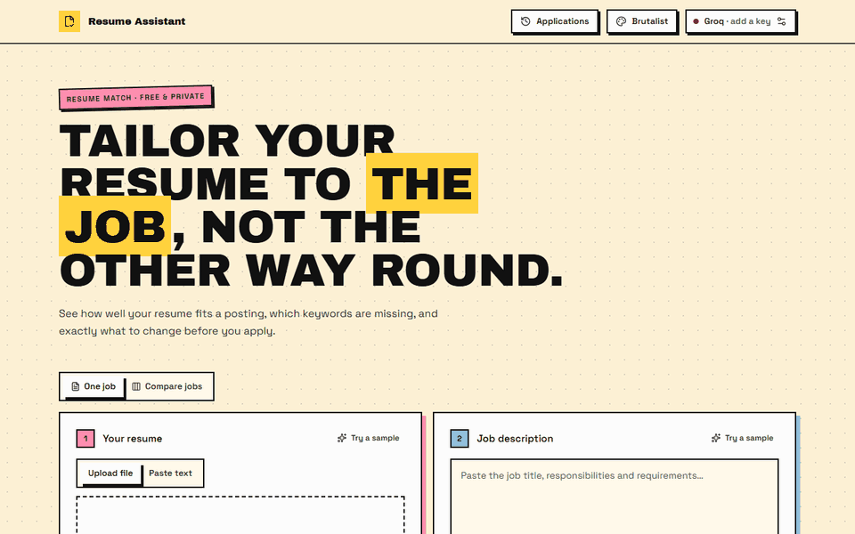
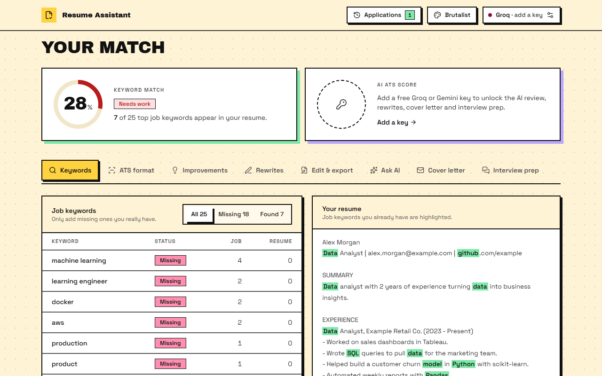
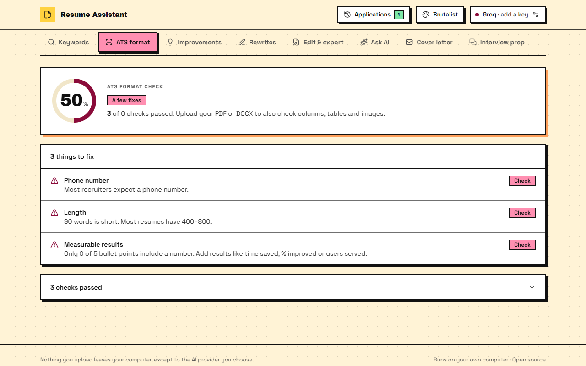
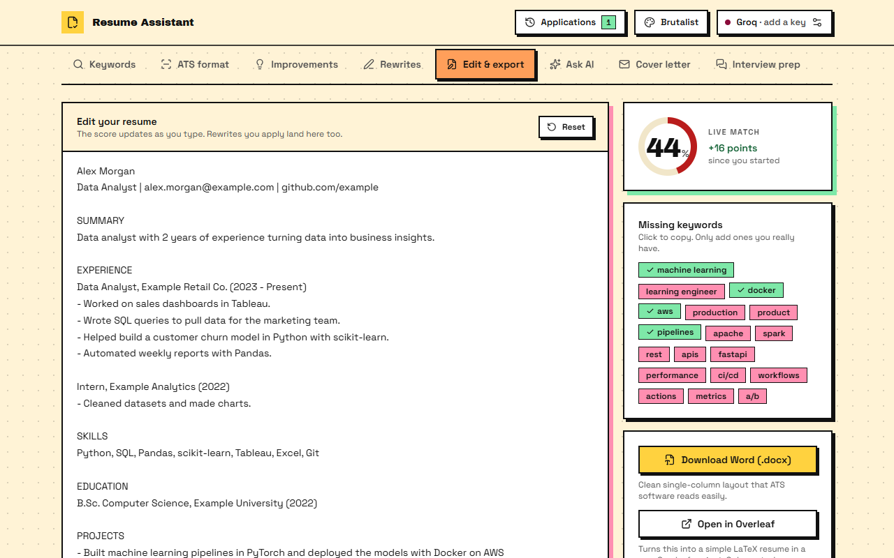
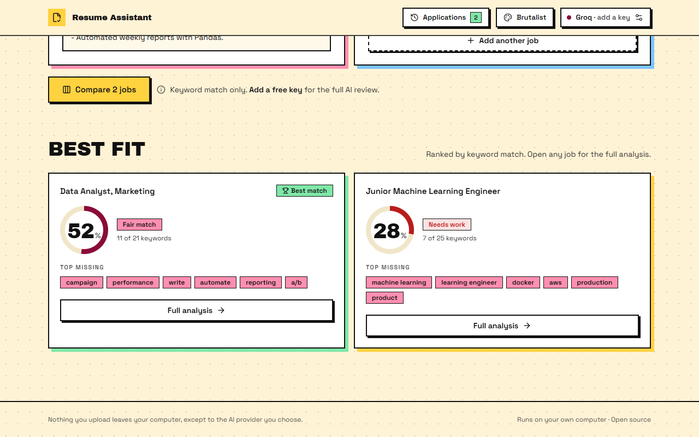

# AI Resume Assistant

Compare your resume with a job posting. The app scores the match, lists the keywords you are missing
and checks the file for formatting that ATS software reads badly. With an AI key it also rewrites
bullet points, writes a cover letter and prepares interview questions.

It runs on your own computer, or you can deploy a copy to Render for other people to use.

Live demo: <https://ai-resume-assistant-xt48.onrender.com> (free hosting, so the first visit after a quiet spell takes about 30 seconds to load)




<br>

## Features

The keyword match, the format check and the editor work without an API key. The AI review needs one,
and free keys work.

| Feature | Needs an API key |
| --- | --- |
| Upload a PDF, DOCX or TXT resume, or paste the text | No |
| Keyword match: a score and a table of job keywords, found or missing, with counts in the job and in your resume | No |
| Your resume with the matched keywords highlighted | No |
| ATS format check: columns, tables, text boxes, images, contact details in headers, missing sections, scanned PDFs | No |
| Editor that re-scores the resume as you type | No |
| Export the edited resume as a single-column Word file (.docx) | No |
| Open the edited resume in Overleaf (LaTeX resumes are sent as they are, others are converted to plain LaTeX) | No |
| Compare one resume against up to 4 job postings | No (AI scores are optional) |
| Application history in your browser, with a status for each job (Saved, Applied, Interviewing, Offer, Rejected) and CSV export | No |
| Download a report as Markdown | No |
| AI score from 0 to 100 with a short verdict | Yes |
| Strengths and a prioritized list of improvements | Yes |
| Bullet point rewrites and a tailored summary, each applied to your resume with one click | Yes |
| Follow-up chat about your results | Yes |
| Cover letter in a professional, enthusiastic or concise tone | Yes |
| Likely interview questions with answer pointers based on your resume | Yes |

The interface has 5 themes (Brutalist, Midnight, Corporate, Sage and Terminal), each in light and dark.
It works on phones and with the keyboard.

| Keyword match | ATS format check |
| --- | --- |
|  |  |
| **Editor with live score** | **Compare jobs** |
|  |  |

The screenshots use the sample resume and job description from [`examples/`](examples/) with no API key.

<br>

## Quick start

You need Python 3.10 or newer and Node.js 20 or newer.

```bash
git clone https://github.com/Vishnuleel/Resume-assistant.git
cd Resume-assistant

python -m venv .venv
# Windows: .venv\Scripts\activate    macOS/Linux: source .venv/bin/activate
pip install -r requirements.txt
cp .env.example .env              # optional: add one key, e.g. a free GROQ_API_KEY

cd web && npm install && npm run build && cd ..
uvicorn server.main:app --port 8787
```

Open <http://localhost:8787>. Instead of using `.env`, you can paste a key into AI settings in the app.
To try it without a resume, click **Try a sample** on both panels.

<br>

## API keys

The keyword match works without a key. For the AI features, pick one provider in AI settings
(top right). Groq and Gemini have free tiers, and Ollama runs on your own computer without a key.

| Provider | Cost | Key | Where to get it |
| --- | --- | --- | --- |
| Groq | Free tier, no credit card | Yes | [console.groq.com/keys](https://console.groq.com/keys) |
| Google Gemini | Free tier | Yes | [aistudio.google.com/apikey](https://aistudio.google.com/apikey) |
| Ollama | Free, runs locally | No | [ollama.com/download](https://ollama.com/download) |
| OpenAI | Paid, cents per analysis | Yes | [platform.openai.com/api-keys](https://platform.openai.com/api-keys) |

Free tiers have per-minute limits. If you hit one, wait a minute or switch provider.

What happens to your key:

- When you run the app yourself, the key stays in your own `.env` file and is only sent to the provider you chose.
- A key typed into AI settings is kept in that browser tab's memory and is never saved or logged.
- The key is only passed to the provider's client in [`resume_assistant/llm.py`](resume_assistant/llm.py).
- A free Groq or Gemini key has no billing attached, and you can revoke it from the provider's dashboard.

If you use a hosted copy of this app that someone else runs, use a free key, not one with billing attached.

### Ollama (no key)

Install Ollama from [ollama.com/download](https://ollama.com/download), then:

```bash
ollama pull llama3.2
```

Start the app and choose "Ollama (local)" in AI settings. Bigger models give better feedback but need
more RAM; `llama3.2` (3B) runs on most laptops.

<br>

## Configuration

Settings go in `.env` (see [`.env.example`](.env.example)). You only need one key.

| Variable | Description |
| --- | --- |
| `GROQ_API_KEY` | Groq key (free) |
| `GEMINI_API_KEY` | Google Gemini key (free) |
| `OPENAI_API_KEY` | OpenAI key (paid) |
| `LLM_PROVIDER` | Provider AI settings starts on: `groq`, `gemini`, `openai` or `ollama` |
| `OPENAI_BASE_URL` | Any other OpenAI-compatible API (e.g. OpenRouter), used under "OpenAI" |
| `OLLAMA_BASE_URL` | Ollama server address (default `http://localhost:11434/v1`) |
| `PUBLIC_MODE` | Set to `1` when hosting for other people (see [Deploying](#deploying)) |

<br>

## Docker

```bash
docker build -t resume-assistant .
docker run -p 8787:8787 --env-file .env resume-assistant
```

Then open <http://localhost:8787>.

<br>

## Deploying

The repository includes a [`render.yaml`](render.yaml) Blueprint and a [`Dockerfile`](Dockerfile), so
it deploys to [Render](https://render.com)'s free plan:

1. Push the repository to GitHub.
2. On Render, choose **New → Blueprint**, pick the repository and click **Apply**.
3. When the build finishes, open the `https://<name>.onrender.com` link.

Render redeploys on every push to `main`. On the free plan the app sleeps after 15 minutes without
visitors, and the next visit takes about 30 seconds to load.

The Blueprint sets `PUBLIC_MODE=1`. In that mode:

- Server keys in the environment are ignored, so visitors always use their own key.
- Ollama is hidden, because it would point at the server, not the visitor's computer.
- Each visitor is limited to 20 AI calls and 120 other calls per minute.

In every mode, resume and job text are limited to 50,000 characters each and uploads to 10 MB.
Don't add API keys to a public deployment.

<br>

## Development

Run the API and the frontend dev server side by side. The frontend reloads as you edit.

```bash
pip install -r requirements-dev.txt
uvicorn server.main:app --reload --port 8787     # terminal 1
cd web && npm run dev                            # terminal 2, http://localhost:5173
```

Run these before opening a pull request:

```bash
pytest                    # backend tests, no API key needed
ruff check . && ruff format .
cd web && npm run build   # type check and production build
```

API docs are at <http://localhost:8787/docs> while the server runs.

### Project structure

```
├── web/                       # Frontend: React + Vite + TypeScript + Tailwind CSS
│   └── src/
│       ├── App.tsx            # Page layout and state
│       ├── api.ts             # Calls to the Python API
│       └── components/        # Inputs, score rings, result tabs, settings drawer
├── server/
│   ├── main.py                # FastAPI: JSON API, serves the built frontend
│   └── ratelimit.py           # Per-visitor rate limits for public hosting
├── resume_assistant/          # The engine (plain Python, no web code)
│   ├── parser.py              # PDF / DOCX / TXT text extraction
│   ├── keywords.py            # Offline keyword extraction, matching, highlighting
│   ├── ats.py                 # ATS formatting checks for PDF / DOCX / text
│   ├── latex_export.py        # LaTeX version of the resume for Overleaf
│   ├── docx_export.py         # Word export of the edited resume
│   ├── llm.py                 # AI client, structured JSON analysis
│   ├── providers.py           # Groq / Gemini / OpenAI / Ollama presets
│   ├── prompts.py             # Prompt templates
│   └── report.py              # Markdown report builder
├── tests/                     # pytest suite
├── examples/                  # Sample resume and job description
├── Dockerfile                 # Builds the frontend and runs the API in one image
├── render.yaml                # Render Blueprint
└── .github/workflows/ci.yml   # Lint, tests, frontend build and Docker build on every push
```

<br>

## Privacy

Your resume is processed in memory and is only sent to the AI provider you choose. With Ollama or the
keyword match alone, it never leaves your computer. Nothing is saved to disk, and `.gitignore` keeps
`.env` and PDF/DOCX files out of the repository.

On a hosted copy, your resume text passes through that server to compute the result and is not saved
or logged. Your application history is stored in your own browser.

<br>

## License

[MIT](LICENSE)
